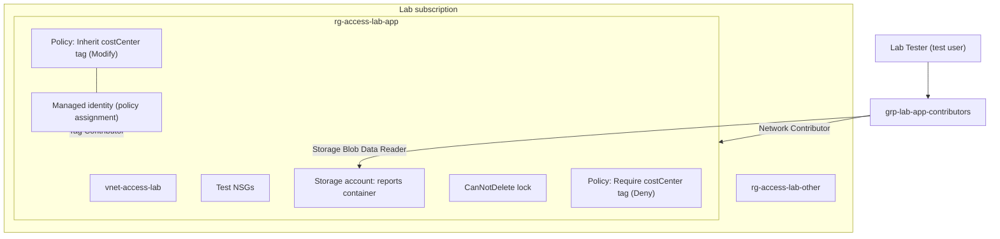

# Azure Access Troubleshooting Lab

Hands-on lab that reproduces, diagnoses, and fixes real Azure "access denied" problems, built while studying for **AZ-104: Microsoft Azure Administrator**. Each scenario follows a support-engineering workflow: **symptom → hypothesis → diagnostics → evidence → root cause → remediation → verification → prevention**, backed by sanitized command output.

> Environment: personal Azure lab subscription. This is hands-on lab work, not production experience.

> **Status (2026-11-04):** All nine scenarios are complete and documented. Scenarios 1-6 were **torn down** on 2026-11-01 ([evidence](docs/evidence/teardown-2026-11-01.txt)); Scenarios 7 (management groups and a policy initiative), 8 (Entra identity lifecycle on a P2 trial) and 9 (Key Vault with a managed identity) were built and **torn down** on 2026-11-04 ([evidence 7](docs/evidence/scenario-7-09-teardown.txt), [8](docs/evidence/scenario-8-09-teardown.txt), [9](docs/evidence/scenario-9-09-teardown.txt)). The Entra test user and group were kept, so the baseline can be redeployed with `main.bicep` for the [live demo](docs/interview-guide.md). *Correction:* an earlier version of this note said custom policy definitions were kept; the 2026-11-04 preflight found none in the subscription.

## Problem It Solves

When a user says "I can't do X in Azure," the cause could be the network, authentication, RBAC (control plane or data plane), a resource lock, or Azure Policy, and each needs a different fix. Changing roles won't fix a lock, and adding permissions won't fix a policy denial. This lab shows how to tell them apart quickly from the error itself and resolve each one with least privilege.

## Error Code Triage

The first diagnostic step is the error code: it tells you **which control** blocked the request.

| Error code | Blocked by | Changing RBAC helps? | Scenario |
|---|---|---|---|
| `AuthorizationFailed` | RBAC: **who** the caller is | ✅ Yes | [1](docs/scenario-1-wrong-scope-rbac.md), [4](docs/scenario-4-policy-remediation-identity.md), [5](docs/scenario-5-storage-data-plane.md) |
| `ScopeLocked` | Resource lock: **protection** | ❌ No, even Owners are blocked | [2](docs/scenario-2-readonly-lock.md) |
| `RequestDisallowedByPolicy` | Azure Policy: **what** is deployed. The error names the assignment and its scope, which may be a **management group** | ❌ No, the request must comply | [3](docs/scenario-3-policy-deny.md), [7](docs/scenario-7-management-groups-initiative.md) |
| `AuthorizationPermissionMismatch` | Storage data-plane RBAC: valid identity, no **data** role | ✅ Yes, a Storage ... Data role | [5](docs/scenario-5-storage-data-plane.md) |
| `AuthenticationFailed` / `NoAuthenticationInformation` | **Authentication**: credential invalid or missing | ❌ No, fix the credential | [5](docs/scenario-5-storage-data-plane.md) |
| `AuthorizationFailure` | Storage **firewall**: request from a network that isn't allowed (checked before credentials) | ❌ No, fix the network rules | [6](docs/scenario-6-storage-firewall.md) |
| `Insufficient privileges to complete the operation` (Graph) | **Entra directory role** scope: the admin's role doesn't cover that user, for example because it's scoped to an administrative unit | ❌ Not Azure RBAC; check the directory role and its scope | [8](docs/scenario-8-entra-identity.md) |
| AADSTS `53003` | **Conditional Access**: sign-in succeeded, then a policy blocked it (here, in a different tenant than intended) | ❌ No, check which tenant and which policy | [8](docs/scenario-8-entra-identity.md) |
| Key Vault `401` `AKV10000` / `AKV10022` | **Authentication**: no token, or a token issued for another service (wrong audience) | ❌ No, fix the token | [9](docs/scenario-9-keyvault-managed-identity.md) |
| Key Vault `403` `ForbiddenByRbac` ("**Caller** is not authorized") | Key Vault **data-plane RBAC**: authenticated, no Key Vault data role at that scope | ✅ Yes, a Key Vault Secrets ... role | [9](docs/scenario-9-keyvault-managed-identity.md) |
| Key Vault `403` "**Client address** is not authorized" | Key Vault **firewall**: the caller's network isn't allowed. Even Owner is blocked | ❌ No, fix the network rules | [9](docs/scenario-9-keyvault-managed-identity.md) |
| Request **timeout** (no HTTP code) | **Network path**: e.g. a private subnet with no route to the service. Nothing reached the service | ❌ No, fix routing (service endpoint, private endpoint) | [9](docs/scenario-9-keyvault-managed-identity.md) |
| `QuotaExceeded` (VM create) | **Subscription quota** for that VM family is 0 or used up; separate from SKU restrictions | ❌ No, pick another family or request quota | [9](docs/scenario-9-keyvault-managed-identity.md) |

## Architecture



| Component | Purpose |
|---|---|
| `rg-access-lab-app` | Where the test user is supposed to work |
| `rg-access-lab-other` | Sibling resource group used to demonstrate a wrong-scope role assignment |
| `grp-lab-app-contributors` | Roles are assigned to the group, not directly to the user |
| CanNotDelete lock | Deletion protection that still allows changes |
| Deny + Modify policies | Enforce and automatically apply the `costCenter` tag |
| Policy managed identity | Runs remediation; granted Tag Contributor only |

## Scenarios

| # | Ticket | Root cause | Fix | Key lesson |
|---|---|---|---|---|
| [1](docs/scenario-1-wrong-scope-rbac.md) | "I can't create anything in the app resource group" | Contributor assigned to the wrong resource group | Network Contributor at the correct scope; stray assignment removed; negative test | Use `--include-groups`; confirm the test identity before trusting a result |
| [2](docs/scenario-2-readonly-lock.md) | "I can't change anything anymore" | ReadOnly lock used where CanNotDelete was intended | Added CanNotDelete first, then removed ReadOnly | `ScopeLocked` means RBAC already allowed the request |
| [3](docs/scenario-3-policy-deny.md) | "My deployment fails with a policy error" | Deny policy requiring `costCenter`, enforced without notice | Resubmitted with the required tag; no governance change | Roll out Deny policies with an audit period first |
| [4](docs/scenario-4-policy-remediation-identity.md) | "The auto-tag policy isn't fixing anything" | Policy managed identity had no role | Tag Contributor (not the declared Contributor), proven by a successful remediation | Read the failing action to choose the narrowest role |
| [5](docs/scenario-5-storage-data-plane.md) | "I can't read the blob" | Reader (control plane) assigned; no data-plane role | Storage Blob Data Reader on the container; Reader removed (lock lifted briefly, with approval) | Owner and Reader don't grant data access; keys bypass RBAC |
| [6](docs/scenario-6-storage-firewall.md) | "Not authorized from home" | Storage firewall set to Deny with only the office IP allowed | Allowed the caller's single IP; RBAC unchanged; redeploy verified the firewall persists | `AuthorizationFailure` is the network, not RBAC; keys can't bypass the firewall |
| [7](docs/scenario-7-management-groups-initiative.md) | "I can't create a resource group, and there's no policy on our subscription" | Initiative (locations + `costCenter` tagging) assigned at a **management group** two levels up, inherited by the subscription | Compliant requests; tagged our own RG; **exemptions** (Waiver, expiry) for Azure-managed RGs; remediation task with a Tag Contributor identity; Bicep at MG scope | Read the error's assignment scope; subscription views don't show MG-inherited policy; audit (DoNotEnforce) before Deny |
| [8](docs/scenario-8-entra-identity.md) | "Our new Finance hire can't get into Finance apps" (plus SSPR, licensing, a contractor guest and a scoped help desk) | New hire's `department` was `FIN`; the dynamic rule needs `Finance` | Fixed the data, not the rule; SSPR scoped to the dynamic group; group-based licensing; guest with Reader on one RG; Helpdesk Administrator scoped to an administrative unit | Validate Rules against a known-good user; "SSPR works unlicensed" is a compliance gap; one attribute change removed group, license and SSPR in 43 s |
| [9](docs/scenario-9-keyvault-managed-identity.md) | "The app on the VM can't read its database secret" (and "I'm Owner but can't see the secrets") | Layered: Owner has no data role; private subnet had no path (timeout); then no role for the VM identity (403); then the vault firewall blocked the Owner | Key Vault Secrets Officer for the admin; **service endpoint** + vault firewall for the subnet; Key Vault Secrets User on **one secret** for the VM identity; /32 for the admin's IP during the lab | Each layer has its own symptom: timeout, 401, 403 `ForbiddenByRbac`, 403 "Client address". Fix the layer the error names |

Each scenario document links its evidence in [`docs/evidence/`](docs/evidence/).

## Repository Structure

| Path | Purpose |
|---|---|
| `main.bicep` | Subscription-scope deployment: tagged resource groups + workload module |
| `modules/workload.bicep` | Baseline VNet and private storage account (`reports` container) in `rg-access-lab-app` |
| `governance/lab-baseline.bicep` | Scenario 7: initiative, assignment and least-privilege policy identity, deployed at **management-group** scope (`az deployment mg`) |
| `keyvault/kv-secret-access.bicep` | Scenario 9: private subnet with a Key Vault service endpoint, RBAC-model vault with firewall rules, and a role assignment scoped to one secret (checked with what-if against the live lab) |
| `docs/scenario-*.md` | One root-cause analysis per scenario |
| `docs/evidence/` | Sanitized command output for every scenario |
| `docs/interview-guide.md` | Live demo script, walkthrough, and interview questions |

## Deploy the Baseline

**Prerequisites:** Azure subscription, [Azure CLI](https://learn.microsoft.com/cli/azure/install-azure-cli), Bicep (`az bicep install`), and permission to create resource groups, role assignments, and policy assignments.

```powershell
az login
az deployment sub what-if --location eastus --template-file main.bicep
az deployment sub create  --location eastus --template-file main.bicep
```

The baseline creates the two resource groups and the VNet, all tagged `project`, `environment`, `owner`, and `costCenter`. The test user, group, roles, lock, and policies for each scenario are created with the CLI commands documented in the scenario files, because each scenario starts from a deliberate misconfiguration.

## Testing as a Second Identity

Access problems must be reproduced **as the affected user**, not as an admin. The lab uses a separate Azure CLI profile:

```powershell
$env:AZURE_CONFIG_DIR = "$HOME\.azure-labtester"
az login --tenant <tenant-id> --allow-no-subscriptions --use-device-code
az account show --query user.name -o tsv   # Must show the test user before any test
```

Sign in through a private browser window so an existing admin session isn't reused.

## Security and Privacy

- All evidence is sanitized: subscription, tenant, and object IDs are replaced with `<guid>`, and real domains with `contoso.onmicrosoft.com`
- No credentials, secrets, or parameter files with real IDs are committed (`*.json` is excluded by `.gitignore`)
- Roles are assigned to groups and managed identities at the **narrowest scope that works** (resource group or a single container), using the narrowest built-in role that worked

## Cost

**$0 since the 2026-11-01 teardown.** Scenario 8 used a free **Microsoft Entra ID P2 trial** with recurring billing turned off, canceled at teardown (final state `Suspended`); its only Azure resource was an empty resource group. Scenario 9 cost under $0.05: about 25 minutes of a D2als_v6 VM and a few hundred Key Vault operations, then deleted and the vault purged. While deployed, it cost under $0.01/month: the only billable resource was one Standard LRS storage account holding a few KB (Scenario 5). Resource groups, VNets, NSGs, RBAC, locks, Azure Policy, managed identities, and test users have no charge.

## Teardown

> **Executed 2026-11-01** ([evidence](docs/evidence/teardown-2026-11-01.txt)): removed `lock-nodelete-app`, removed the two role assignments scoped to `rg-access-lab-app` (Network Contributor for `grp-lab-app-contributors`, Tag Contributor for the policy's managed identity), then deleted `rg-access-lab-app` and the empty `rg-access-lab-other`. **Kept on purpose:** the Entra group and test user (free, needed to redeploy the demo). The last three commands below weren't run.
>
> The lock must be removed first, or the resource group deletion fails with `ScopeLocked`.

```powershell
$rgId = az group show --name rg-access-lab-app --query id -o tsv
az lock delete --name lock-nodelete-app --resource-group rg-access-lab-app
az policy assignment delete --name inherit-costcenter-tag --scope $rgId
az policy assignment delete --name require-costcenter-tag --scope $rgId
az group delete --name rg-access-lab-app   --yes
az group delete --name rg-access-lab-other --yes
az ad group delete --group grp-lab-app-contributors
az ad user delete --id labtester@<your-tenant>.onmicrosoft.com
Remove-Item "$HOME\.azure-labtester" -Recurse
```

## AZ-104 Objectives Covered

| Domain | Objective |
|---|---|
| Manage Azure identities and governance | Manage built-in Azure roles; assign roles at different scopes; interpret access assignments |
| Manage Azure identities and governance | Implement and manage Azure Policy; configure resource locks; apply and manage tags; manage resource groups |
| Manage Azure identities and governance | Manage management groups; assign RBAC and policy at management-group scope; policy initiatives, exemptions and remediation tasks |
| Manage Azure identities and governance | Create users and groups |
| Manage Azure identities and governance | Manage user and group properties; manage licenses in Microsoft Entra ID (group-based); manage external users; configure self-service password reset; administrative units and dynamic membership |
| Deploy and manage Azure compute resources | Create a VM; configure a managed identity; choose a VM size within quota |
| Implement and manage virtual networking | Configure service endpoints; private subnets (no default outbound access) |
| Deploy and manage Azure compute resources | Interpret, modify, and deploy Bicep files |
| Implement and manage storage | Create and configure storage accounts; create and configure a container in Azure Blob Storage; manage access keys; configure Azure Storage firewalls and virtual networks |

## Lessons Learned

- **Confirm the test identity first.** My first reproduction "passed" because it ran as the admin account; the Activity Log showed the real caller.
- **RBAC changes aren't instant.** The fix in Scenario 1 needed time to apply and a fresh sign-in.
- **The error code is the fastest diagnostic.** `AuthorizationFailed`, `ScopeLocked`, `RequestDisallowedByPolicy`, `AuthorizationPermissionMismatch`, and `AuthenticationFailed` each point to a different control, and the last one isn't a permissions problem at all.
- **Least privilege can be proven.** In Scenario 4, Tag Contributor was enough, even though the policy definition declares Contributor.
- **IaC can undo manual fixes.** Bicep tags replace existing tags; what-if showed a redeploy would have removed `costCenter` until the template was updated.
- **Owner doesn't mean data access.** Reading a blob with Entra ID needs a Storage ... Data role. Control-plane roles manage the account, and account keys bypass RBAC entirely, which is why Reader can't list them.
- **Locks protect role assignments too.** The CanNotDelete lock blocked removing an unneeded role assignment, even for an Owner.
- **Check what a test actually sent.** On Windows, `az` passes arguments through cmd.exe, which split a SAS URL at `&`; `Invoke-WebRequest` sent it intact.
- **The network is checked first.** A storage firewall rejected even the account key; `AuthorizationFailure` and `AuthorizationPermissionMismatch` differ by one word but need different fixes.
- **Policy can live above the subscription.** In Scenario 7 a Deny came from a management group two levels up; the subscription's assignment list didn't show it, but the error named its scope.
- **Audit first, then enforce.** `DoNotEnforce` reported exactly who a Deny would affect before anyone's deployment failed.
- **Reporting and enforcement run on different clocks.** The first full compliance evaluation took about 45 minutes, and exemptions showed as Exempt only after a re-scan, while enforcement honored them immediately.
- **Bicep manages only what it declares.** Undeclared firewall rules survived a real redeploy (what-if predicted it, and the deployment confirmed it), unlike the declared tags in Scenario 4.
- **Dynamic rules are only as good as the data.** In Scenario 8 a new hire was missing because `department` said `FIN`; Validate Rules against a known-good user proved it was the data, not the rule.
- **"It works" isn't "it's licensed."** SSPR worked for an unlicensed user; Microsoft documents that some tenant features can't block unlicensed users, so the license gap had to be closed with group-based licensing.
- **The audit log proves automation.** A department change removed group membership after 21 s and the license after 43 s, each logged as done by a Microsoft service, not a person.
- **Licenses follow the person who uses the feature.** The portal refused to scope a role to an administrative unit until the delegated admin had their own P2 license.
- **Denied attempts may not reach the Activity Log.** A guest's `AuthorizationFailed` writes weren't logged there within about 20 minutes (unconfirmed), so Activity Log alerts can't be relied on to catch them.
- **Peel the layers in order.** In Scenario 9 the same request failed four different ways: a timeout (network path), 401 (wrong token), 403 `ForbiddenByRbac` (no role), 403 "Client address" (firewall). Each fix moved the error to the next layer.
- **A managed identity removes the credential, not the authorization.** The VM got a token with no stored secret; it still needed a role, scoped here to one secret.
- **SKU availability isn't quota.** A size can pass `list-skus` and still fail with `QuotaExceeded`; check `az vm list-usage` too.
- **Soft delete reserves the name.** A deleted secret's name can't be reused until it's recovered or purged, and the secret-scoped role assignment survived the delete and recovery.

## Limitations and Future Improvements

- Scenario misconfigurations, role assignments, locks, policy assignments, and storage firewall rules are created with the CLI, not yet defined in Bicep
- Scenario 8 was built in the portal and with Microsoft Graph calls, not in code; Entra objects (users, groups, administrative units, SSPR settings) aren't Bicep resources
- Scenario 8 needed a P2 trial; reproducing it needs a P1/P2 license or another trial
- Scenario 9's Bicep covers the network, vault and role assignment but not the VM or the secret value; it was checked with what-if, not deployed
- Accepted risk: the owner account keeps **User Access Administrator at the root scope** (elevated access) in this single-admin lab; in production it would be turned off after use
- Demo script and interview guide: [docs/interview-guide.md](docs/interview-guide.md)
