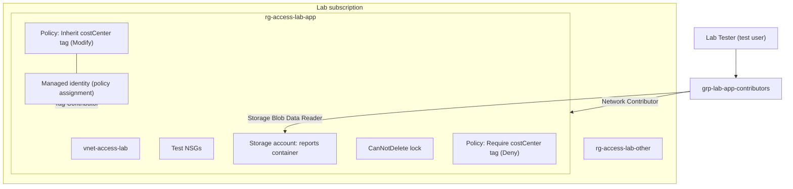

# Azure Access Troubleshooting Lab

Hands-on lab that reproduces, diagnoses, and fixes real Azure "access denied" problems, built while studying for **AZ-104: Microsoft Azure Administrator**. Each scenario follows a support-engineering workflow: **symptom → hypothesis → diagnostics → evidence → root cause → remediation → verification → prevention**, backed by sanitized command output.

> Environment: personal Azure lab subscription. This is hands-on lab work, not production experience.

## Problem It Solves

When a user says "I can't do X in Azure," the cause could be authentication, RBAC (control plane or data plane), a resource lock, or Azure Policy, and each needs a different fix. Changing roles won't fix a lock, and adding permissions won't fix a policy denial. This lab shows how to tell them apart quickly from the error itself and resolve each one with least privilege.

## Error Code Triage

The first diagnostic step is the error code: it tells you **which control** blocked the request.

| Error code | Blocked by | Changing RBAC helps? | Scenario |
|---|---|---|---|
| `AuthorizationFailed` | RBAC: **who** the caller is | ✅ Yes | [1](docs/scenario-1-wrong-scope-rbac.md), [4](docs/scenario-4-policy-remediation-identity.md), [5](docs/scenario-5-storage-data-plane.md) |
| `ScopeLocked` | Resource lock: **protection** | ❌ No, even Owners are blocked | [2](docs/scenario-2-readonly-lock.md) |
| `RequestDisallowedByPolicy` | Azure Policy: **what** is deployed | ❌ No, the request must comply | [3](docs/scenario-3-policy-deny.md) |
| `AuthorizationPermissionMismatch` | Storage data-plane RBAC: valid identity, no **data** role | ✅ Yes, a Storage ... Data role | [5](docs/scenario-5-storage-data-plane.md) |
| `AuthenticationFailed` / `NoAuthenticationInformation` | **Authentication**: credential invalid or missing | ❌ No, fix the credential | [5](docs/scenario-5-storage-data-plane.md) |

## Architecture



| Component | Purpose |
|---|---|
| `rg-access-lab-app` | Where the test user is supposed to work |
| `rg-access-lab-other` | Sibling resource group used to demonstrate a wrong-scope role assignment |
| `grp-lab-app-contributors` | Roles are assigned to the group, not directly to the user |
| CanNotDelete lock | Deletion protection that still allows changes |
| Deny + Modify policies | Enforce and automatically apply the `costCenter` tag |
| Policy managed identity | Runs remediation; granted Tag Contributor only |

## Scenarios

| # | Ticket | Root cause | Fix | Key lesson |
|---|---|---|---|---|
| [1](docs/scenario-1-wrong-scope-rbac.md) | "I can't create anything in the app resource group" | Contributor assigned to the wrong resource group | Network Contributor at the correct scope; stray assignment removed; negative test | Use `--include-groups`; confirm the test identity before trusting a result |
| [2](docs/scenario-2-readonly-lock.md) | "I can't change anything anymore" | ReadOnly lock used where CanNotDelete was intended | Added CanNotDelete first, then removed ReadOnly | `ScopeLocked` means RBAC already allowed the request |
| [3](docs/scenario-3-policy-deny.md) | "My deployment fails with a policy error" | Deny policy requiring `costCenter`, enforced without notice | Resubmitted with the required tag; no governance change | Roll out Deny policies with an audit period first |
| [4](docs/scenario-4-policy-remediation-identity.md) | "The auto-tag policy isn't fixing anything" | Policy managed identity had no role | Tag Contributor (not the declared Contributor), proven by a successful remediation | Read the failing action to choose the narrowest role |
| [5](docs/scenario-5-storage-data-plane.md) | "I can't read the blob" | Reader (control plane) assigned; no data-plane role | Storage Blob Data Reader on the container; Reader removed (lock lifted briefly, with approval) | Owner and Reader don't grant data access; keys bypass RBAC |

Each scenario document links its evidence in [`docs/evidence/`](docs/evidence/).

## Repository Structure

| Path | Purpose |
|---|---|
| `main.bicep` | Subscription-scope deployment: tagged resource groups + workload module |
| `modules/workload.bicep` | Baseline VNet and private storage account (`reports` container) in `rg-access-lab-app` |
| `docs/scenario-*.md` | One root-cause analysis per scenario |
| `docs/evidence/` | Sanitized command output for every scenario |
| `docs/interview-guide.md` | Live demo script, walkthrough, and interview questions |

## Deploy the Baseline

**Prerequisites:** Azure subscription, [Azure CLI](https://learn.microsoft.com/cli/azure/install-azure-cli), Bicep (`az bicep install`), and permission to create resource groups, role assignments, and policy assignments.

```powershell
az login
az deployment sub what-if --location eastus --template-file main.bicep
az deployment sub create  --location eastus --template-file main.bicep
```

The baseline creates the two resource groups and the VNet, all tagged `project`, `environment`, `owner`, and `costCenter`. The test user, group, roles, lock, and policies for each scenario are created with the CLI commands documented in the scenario files, because each scenario starts from a deliberate misconfiguration.

## Testing as a Second Identity

Access problems must be reproduced **as the affected user**, not as an admin. The lab uses a separate Azure CLI profile:

```powershell
$env:AZURE_CONFIG_DIR = "$HOME\.azure-labtester"
az login --tenant <tenant-id> --allow-no-subscriptions --use-device-code
az account show --query user.name -o tsv   # Must show the test user before any test
```

Sign in through a private browser window so an existing admin session isn't reused.

## Security and Privacy

- All evidence is sanitized: subscription, tenant, and object IDs are replaced with `<guid>`, and real domains with `contoso.onmicrosoft.com`
- No credentials, secrets, or parameter files with real IDs are committed (`*.json` is excluded by `.gitignore`)
- Roles are assigned to groups and managed identities at the **narrowest scope that works** (resource group or a single container), using the narrowest built-in role that worked

## Cost

**Under $0.01/month.** The only billable resource is one Standard LRS storage account holding a few KB (Scenario 5). Resource groups, VNets, NSGs, RBAC, locks, Azure Policy, managed identities, and test users have no charge.

## Teardown

> **Not yet executed.** These steps are documented for when the lab is finished. The lock must be removed first, or the resource group deletion fails with `ScopeLocked`.

```powershell
$rgId = az group show --name rg-access-lab-app --query id -o tsv
az lock delete --name lock-nodelete-app --resource-group rg-access-lab-app
az policy assignment delete --name inherit-costcenter-tag --scope $rgId
az policy assignment delete --name require-costcenter-tag --scope $rgId
az group delete --name rg-access-lab-app   --yes
az group delete --name rg-access-lab-other --yes
az ad group delete --group grp-lab-app-contributors
az ad user delete --id labtester@<your-tenant>.onmicrosoft.com
Remove-Item "$HOME\.azure-labtester" -Recurse
```

## AZ-104 Objectives Covered

| Domain | Objective |
|---|---|
| Manage Azure identities and governance | Manage built-in Azure roles; assign roles at different scopes; interpret access assignments |
| Manage Azure identities and governance | Implement and manage Azure Policy; configure resource locks; apply and manage tags; manage resource groups |
| Manage Azure identities and governance | Create users and groups |
| Deploy and manage Azure compute resources | Interpret, modify, and deploy Bicep files |
| Implement and manage storage | Create and configure storage accounts; create and configure a container in Azure Blob Storage; manage access keys |

## Lessons Learned

- **Confirm the test identity first.** My first reproduction "passed" because it ran as the admin account; the Activity Log showed the real caller.
- **RBAC changes aren't instant.** The fix in Scenario 1 needed time to apply and a fresh sign-in.
- **The error code is the fastest diagnostic.** `AuthorizationFailed`, `ScopeLocked`, `RequestDisallowedByPolicy`, `AuthorizationPermissionMismatch`, and `AuthenticationFailed` each point to a different control, and the last one isn't a permissions problem at all.
- **Least privilege can be proven.** In Scenario 4, Tag Contributor was enough, even though the policy definition declares Contributor.
- **IaC can undo manual fixes.** Bicep tags replace existing tags; what-if showed a redeploy would have removed `costCenter` until the template was updated.
- **Owner doesn't mean data access.** Reading a blob with Entra ID needs a Storage ... Data role. Control-plane roles manage the account, and account keys bypass RBAC entirely, which is why Reader can't list them.
- **Locks protect role assignments too.** The CanNotDelete lock blocked removing an unneeded role assignment, even for an Owner.
- **Check what a test actually sent.** On Windows, `az` passes arguments through cmd.exe, which split a SAS URL at `&`; `Invoke-WebRequest` sent it intact.

## Limitations and Future Improvements

- Scenario misconfigurations, role assignments, locks, and policy assignments are created with the CLI, not yet defined in Bicep
- Planned: **Key Vault** access by a managed identity (authentication vs. authorization is now covered in Scenario 5)
- Demo script and interview guide: [docs/interview-guide.md](docs/interview-guide.md)
- Teardown steps are documented but not yet executed
