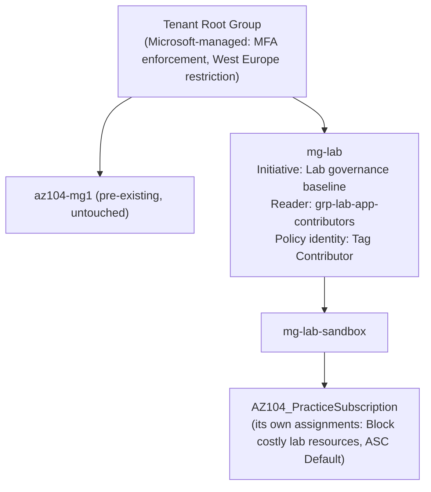

# Scenario 7: "I can't create a resource group, and there's no policy on our subscription"

**Ticket:** A user couldn't create a resource group in West US, and couldn't create one in East US without a `costCenter` tag. They checked Azure Policy on the subscription and found nothing that blocks regions or requires tags.

**Status:** Resolved, verified and torn down · **Environment:** Personal Azure lab subscription (not production) · **Date:** 2026-11-04

## Background: what was built

This scenario extends the lab from resource-group scope (Scenarios 3 and 4) to **management groups**:

| Component | Detail |
|---|---|
| Hierarchy | `mg-lab` → `mg-lab-sandbox` → the subscription (created and moved in the portal; the move needed no extra permission) |
| Initiative | **Lab governance baseline**, defined at `mg-lab`: *Allowed locations*, *Allowed locations for resource groups*, *Require a tag on resource groups*, *Inherit a tag from the resource group if missing*. Two initiative parameters: `allowedLocations` (default `["eastus"]`) and `tagName` (default `costCenter`) |
| Assignment | `lab-baseline` at `mg-lab`, created from the CLI in **DoNotEnforce** first, then enforced in the portal |
| Policy identity | System-assigned; **Tag Contributor** at `mg-lab`. The portal would grant the definition's Contributor |
| RBAC inheritance test | `grp-lab-app-contributors` (Lab Tester) given **Reader at `mg-lab`** |
| Exemptions | Waiver, tag policy only, 2-week expiry, for the Azure-managed `NetworkWatcherRG` (portal) and `DefaultResourceGroup-EUS` (CLI) |

Preflight findings ([`scenario-7-00-preflight.txt`](evidence/scenario-7-00-preflight.txt)): the hierarchy was already active; an unrelated empty `az104-mg1` existed; the Tenant Root Group holds three **Microsoft-managed** assignments (mandatory MFA Phase 2 for write and delete actions, and a West Europe region restriction); and three resource groups lacked `costCenter` (`rg-hubspoke-lab`, `NetworkWatcherRG`, `DefaultResourceGroup-EUS`). No custom policy definitions existed, although this README previously said they were kept.

## 1. Symptom

| Test | Request | Result |
|---|---|---|
| T1 | `az group create -l westus --tags costCenter=CC-1001` | `RequestDisallowedByPolicy` |
| T2 | `az group create -l eastus` (no tag) | `RequestDisallowedByPolicy` |
| T3 | `az group create -l eastus --tags costCenter=CC-1001` | Created (then deleted): compliant requests pass |

What the requester saw at subscription scope (`az policy assignment list --disable-scope-strict-match`): only *Block costly lab resources* and *ASC Default*.

Evidence: [`scenario-7-04-enforce-deny.txt`](evidence/scenario-7-04-enforce-deny.txt)

## 2. Initial hypothesis

A policy assigned **above** the subscription (a management group) is inherited and denies the requests, but it isn't listed among the subscription's own assignments.

## 3. Diagnostics

1. **Read the denial itself.** The `RequestDisallowedByPolicy` error names the assignment, its scope and the policy inside the initiative:
   - T1: assignment **Lab governance baseline (mg-lab)**, scope `/providers/Microsoft.Management/managementGroups/mg-lab`, policy **Allowed locations for resource groups**
   - T2: the same assignment, policy **Require a tag on resource groups**
2. **Look the assignment up at its real scope:** `enforcementMode: Default` (enforced) and no parameter override, so the initiative default `["eastus"]` applies.
3. **Confirmed separately:** even with `lab-baseline` assigned at `mg-lab`, the subscription-scope listing above does not show it (this CLI version). That listing is not proof that nothing applies.

## 4. Root cause

An initiative assigned at the `mg-lab` management group (two levels above the subscription) was inherited by the subscription. *Allowed locations for resource groups* denied West US; *Require a tag on resource groups* denied the untagged group. The plain *Allowed locations* policy doesn't evaluate resource groups, which is why the initiative includes both.

## 5. Remediation

This was policy working as designed, so the fix was to the requests and to genuine exceptions, not to the policy:

- Requests resubmitted compliant (T3).
- `rg-hubspoke-lab` (our own group, simply missing the tag) **tagged** `costCenter=CC-1001`.
- The two **Azure-managed** groups got **exemptions** (Waiver, tag policy only, with expiry) rather than exclusions, so they stay visible as *Exempt* and stay subject to the location rules.
- The one existing resource missing the tag (`bv-backup-lab`) fixed by a **remediation task**.

## 6. Verification

| Check | Result | Evidence |
|---|---|---|
| RBAC inheritance | Lab Tester went from no subscriptions to **AZ104_PracticeSubscription + 7 resource groups** after Reader at `mg-lab`; from the subscription, `--include-inherited --scope` shows the assignment with the `mg-lab` scope | `scenario-7-02` |
| Modify at create time | NSG created **without tags** in a tagged RG came back with `{"costCenter":"CC-1001"}` | `scenario-7-05` |
| Remediation | Task scoped to the subscription with **ReEvaluateCompliance**: Succeeded 1/1 in about 17 min; the vault now has `costCenter`; the identity only had Tag Contributor | `scenario-7-05` |
| Exemption (enforcement) | Updating `DefaultResourceGroup-EUS`: denied before the exemption, allowed immediately after | `scenario-7-06` |
| Compliance (final) | 56 states; both exempted RGs reported **Exempt** after a re-scan; everything else Compliant | `scenario-7-07`, `scenario-7-09` |
| Code | Bicep at management-group scope; what-if pass 2: assignment NoChange, initiative only the service-computed `versions` list, role assignment planned as a create (name mismatch, explained below) | `scenario-7-08` |
| Teardown | Exemptions, identity roles, assignment, initiative, group Reader removed; subscription back under the Tenant Root Group; both MGs deleted; a West US RG could be created again (then deleted) | `scenario-7-09` |

## 7. What went wrong along the way (real findings)

| Finding | Cause | Lesson |
|---|---|---|
| Lab Tester saw no subscriptions for 5.6 min | The test profile had **no signed-in account**; `2>$null` hid "Please run az login" | Confirm the test identity is authenticated before trusting a negative result (same lesson as Scenario 1) |
| First compliance read: 10 states, VNets only, no RG policies | First full evaluation still in progress; my loop stopped at the first non-empty result | Don't treat a partial result as complete; the vault appeared about 45 min after assignment |
| Exempted RGs still NonCompliant right after the exemptions | The compliance report updates on the next evaluation; enforcement honored the exemption immediately | Reporting and enforcement run on different clocks |
| Teardown removed **two** role assignments for the policy identity, though only Tag Contributor was granted and listed at 11:14 | Not confirmed. Hypothesis: editing the assignment in the portal (to enable enforcement) granted the definition's `roleDefinitionIds` (Contributor) automatically | If a Modify or DeployIfNotExists assignment is edited in the portal, re-check the identity's roles afterwards |
| What-if planned a `+ Create` for the identity's role assignment | The CLI created it with a random name; the template uses a deterministic `guid()`. A deploy would fail with `RoleAssignmentExists` | What-if compares by name. Don't deploy over CLI-created role assignments; use `guid()` names from the start |

## 8. Prevention

- **Roll out with `DoNotEnforce` first**, read compliance, fix or exempt, then enforce (Scenario 3's lesson, applied).
- Define the initiative, assignment and identity role in **Bicep** (`governance/lab-baseline.bicep`), with pinned `definitionVersion`s so a new major version of a built-in can't change behavior silently.
- Use **exemptions with an expiry and a reason**, not exclusions, for genuine exceptions.
- When a policy error is reported, **read the error's assignment ID and scope first**, then check the management group hierarchy.

## Interview takeaway

"A Deny that nobody can find on the subscription is almost always inherited from a management group. The `RequestDisallowedByPolicy` error names the assignment and its scope, which here was a management group two levels up. I rolled the initiative out in audit mode, fixed the one group of ours that was missing a tag, exempted the two Azure-managed groups with an expiry, remediated the existing resource with a least-privilege identity, and codified it all in Bicep at management-group scope."
