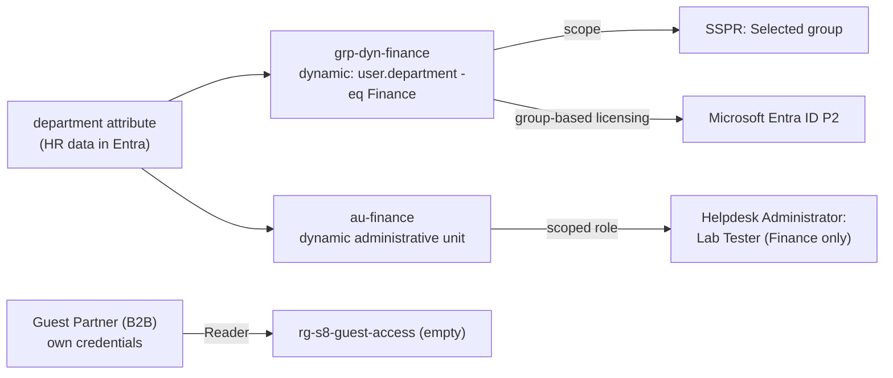

# Scenario 8: Entra identity lifecycle (dynamic groups, SSPR, group-based licensing, guests, administrative units)

**Tickets:**
1. "Our new Finance hire can't get into any Finance apps."
2. "Can Finance users reset their own passwords instead of calling the help desk?"
3. "We have premium features turned on, but are we actually licensed for the people using them?"
4. "A contractor needs read access to one project in Azure, nothing else."
5. "The Finance help desk should reset Finance passwords only, not everyone's."

**Status:** Resolved, verified and torn down · **Environment:** Personal lab tenant and subscription (not production) · **Date:** 2026-11-04

## Background: what was built

| Component | Detail |
|---|---|
| Licensing | **Microsoft Entra ID P2 trial** (100 licenses, free, recurring billing Off). Activated by a cloud-only Global Administrator, `labadmin`, because the tenant owner signs in with a personal Microsoft account |
| Test users | Alex and Blair (Finance), Casey (Sales), Drew (new Finance hire, created with `department = FIN`) |
| Dynamic group | `grp-dyn-finance`, rule `(user.department -eq "Finance")`, created in the portal |
| SSPR | Scope **Selected → grp-dyn-finance**; 1 method required; registration required at sign-in; Microsoft Authenticator enabled for all users in the Authentication methods policy |
| Group-based licensing | P2 assigned to `grp-dyn-finance` |
| Guest | B2B invitation to an outside email account; **Reader** on one empty resource group |
| Administrative unit | `au-finance`, dynamic, same rule; **Helpdesk Administrator** scoped to the AU, assigned to Lab Tester |

Evidence files: [`scenario-8-00`](evidence/scenario-8-00-preflight.txt) through [`scenario-8-05`](evidence/scenario-8-05-admin-unit.txt), and [`scenario-8-09`](evidence/scenario-8-09-teardown.txt) for teardown.

## Setup findings (before the scenario started)

| Finding | Cause | Fix |
|---|---|---|
| `entra.microsoft.com` sign-in: *"Your sign-in was successful but you don't have permission"*, error **53003** | With no tenant in the URL, the portal picked a **university tenant** where the account is a guest. Conditional Access there blocks unregistered devices. **Authentication succeeded; Conditional Access denied.** (Seen on the portal error page; not in the evidence file.) | Tenant-specific URL: `entra.microsoft.com/<tenantId>` |
| **Try / Buy** greyed out under Licenses | The tenant owner is a **personal Microsoft account**; in the tenant it shows as `…#EXT#` (external), and license trials need an organizational account in the tenant | Created cloud-only `labadmin` (Global Administrator), activated the trial as that account |
| The trial briefly showed **Disabled** after recurring billing was set to Off, while Graph still reported `capabilityStatus=Enabled` | Turning off recurring billing on the free trial ended it immediately instead of at the end of the term | **Reactivate subscription**: Active, "Off, expires on 12/4/2026" |

## Milestone 1: "Our new Finance hire isn't in the Finance group"

**Symptom.** Alex and Blair joined `grp-dyn-finance` **0.6 min** after it was created. Drew, the new Finance hire, never did.

**Hypotheses, most likely first:** (1) processing delay; (2) wrong rule; (3) bad attribute data; (4) account state.

**Diagnostics.**
- Processing delay was weak from the start: the other two joined within a minute.
- Graph showed the attribute values in quotes: Drew `department='FIN'`, Alex `department='Finance'`.
- The portal's **Validate Rules** tool, run against Drew and a known-good control (Alex): *Drew does not meet rule; department = FIN*. Alex meets it.

**Root cause.** A **data defect**, not a rule defect. The rule requires exactly `Finance`, and the new hire's record said `FIN`.

**Remediation.** Fixed the data (`FIN` → `Finance`) instead of widening the rule. A rule like `-in ["Finance","FIN"]` would build the data error into the access control.

**Verification.** Drew was a member at the first check after the change (+0.0 min). Negative check: Casey (Sales) was **not** a member.

## Milestone 2: SSPR scoped to the Finance group

**Hypothesis under test.** An **unlicensed** in-scope user would be refused with *"We could not verify your account"*, as Microsoft's troubleshooting article describes.

**Result: not confirmed.** Alex had **0 licenses** and still reset her password: `Reset password (self-service) result=success` at 13:58:59 in the Entra audit log. This matches Microsoft's licensing doc: some tenant services can't limit the benefit to licensed users, but **a license is still required** for anyone meant to use the feature. Here, "it works" was a **compliance gap**, not proof of entitlement. Milestone 3 closes it.

**Negative test.** Casey (Sales, out of scope) was blocked with *"You can't reset your own password because password reset isn't turned on for your account."* The audit log's reason: *"This user is not a member of the password reset users group."*

## Milestone 3: Group-based licensing, and the mover test

- P2 assigned to `grp-dyn-finance`: **3 of 3** Finance members had an active inherited license (`assignedByGroup` = the group) at the first check. Casey had none. Tenant count: **assigned=3**.
- **Mover test:** Blair's department was changed from Finance to Sales. The audit log timed the automation:

| Time | Event | Done by |
|---|---|---|
| 14:10:18 | Update user (department → Sales) | Admin |
| 14:10:39 | Remove member from group | Microsoft Approval Management (+21 s) |
| 14:11:01 | Change user license | Microsoft Azure AD Group-Based Licensing (+43 s) |

The tenant count dropped to **assigned=2**. One attribute change removed group membership, the license and SSPR scope, with no manual step.

## Milestone 4: Guest (B2B) access to one resource group

- Tenant settings: anyone can invite guests; guest directory access is **limited (default)**.
- After the invitation: `userType=Guest`, `externalUserState=PendingAcceptance`, `creationType=Invitation`, UPN contains `#EXT#`.
- **Finding:** after redemption, a lookup by the invited name returned nothing. **Redemption overwrote the display name** with the name from the guest's own account. The guest was found by listing all guests, then renamed back.
- **Least privilege:** Reader on one empty resource group; the guest's only role assignment.
- **Positive test:** the guest signed in to the Azure portal with their own account and saw `rg-s8-guest-access`. The classic *"I accepted but can't see anything"* ticket **was not reproduced**, because this guest account has no Azure directory of its own.
- **Negative test (CLI, as the guest):** reading the group succeeded; writing a tag failed with `AuthorizationFailed ... does not have authorization to perform action 'Microsoft.Resources/tags/write'`.

**Finding (unconfirmed):** neither the portal attempt nor the CLI attempt appeared in the subscription **Activity Log** within about 20 minutes, even with a subscription-wide search for the guest as caller. So Activity Log alerts, like the ones in the monitoring project, may not catch **denied** attempts; detecting them would need another source. The portal attempt may also have been blocked by the portal's own permission check before any request reached Azure Resource Manager.

## Milestone 5: Administrative unit with a scoped help desk admin

- `au-finance`: dynamic membership, `(user.department -eq "Finance")`. Members: **Alex and Drew** (Blair had already moved to Sales).
- **Helpdesk Administrator** scoped to `au-finance`, assigned to Lab Tester.
- **Blocker:** the portal said *"To assign roles at resource scope, your organization needs Microsoft Entra ID Premium P1 or P2"*, although the tenant had P2. **Cause:** administrative-unit administrators need their **own** P1/P2 license. **Fix:** set `usageLocation = US` (a direct license assignment fails without it), assigned P2 directly to Lab Tester and Lab Admin; the scoped assignment was then in place.

| Test as Lab Tester | Result |
|---|---|
| Reset Alex's password (inside the AU) | **Allowed**, `exit=0` |
| Reset Casey's password (outside the AU) | **Denied**, `Insufficient privileges to complete the operation` |

## Teardown

SSPR set back to **None** (its original value) → guest resource group, guest, AU, test users deleted → Lab Tester's direct license removed → group license removed, then the group deleted → trial **canceled** as Lab Admin → Lab Admin deleted **last**. Final state: `AAD_PREMIUM_P2 status=Suspended assigned=0`. Lab Tester and the pre-existing guest were kept.

**Finding:** `az ad group delete` refused with *"A group with active licenses assigned cannot be deleted."* Group licenses must be removed first, a safeguard against removing a whole department's licenses by accident. My teardown plan had assumed otherwise.

## What went wrong along the way

| Finding | Lesson |
|---|---|
| A `System.Web` password generator doesn't exist in PowerShell 7, so the first admin-creation attempt failed. Nothing was created, because each later step failed on the missing value | Run multi-step changes as one block that stops at the first failure |
| Time placeholders like `<HH:mm>` ended up in the evidence | Read values with prompts, or take timestamps from the audit log |
| A verification script started with `Set-Content`, erasing earlier lines in the same file | Use `Set-Content` only for the first block of a new file; append afterwards |

## Prevention

- **Standardize the attributes rules depend on** (picklists at the source) and report on values outside the approved list.
- **License through groups**, so access and licensing follow the same attribute, and remove a group's licenses before deleting the group.
- **Scope delegated admin roles with administrative units**, and license the delegated admins.
- **Check guest access by object ID**, not display name.
- **Don't rely on the Activity Log alone** to detect denied access attempts.

## Interview takeaway

"I built a joiner-mover-leaver chain in Entra: one HR attribute drives a dynamic group, which scopes self-service password reset and assigns licenses, plus an administrative unit that limits a help desk admin to Finance users. The best moments were the failures. A new hire missing from the group turned out to be bad data, `FIN` instead of `Finance`, which I proved with Validate Rules against a known-good user. SSPR worked for an unlicensed user, which looked like success but was really a licensing gap, so I fixed it with group-based licensing. And the audit log showed a department change removing membership and the license within 43 seconds, with no manual steps."
