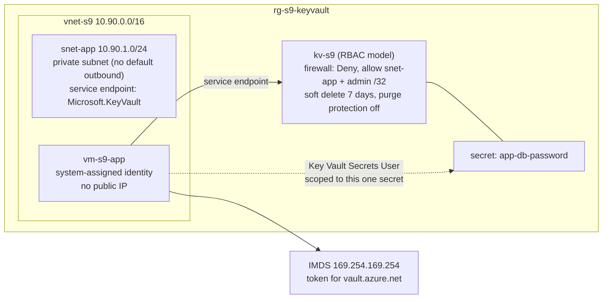

# Scenario 9: "The app on the VM can't read its database secret"

**Tickets:**
1. "I'm Owner on the subscription, but I can't create a secret in the new vault."
2. "The app on the VM can't read its database password from Key Vault."
3. "Now I can't open the vault's secrets from my laptop, and I'm still Owner."
4. "Someone deleted the app's secret."

**Status:** Resolved, verified and torn down · **Environment:** Personal Azure lab subscription (not production) · **Date:** 2026-11-04

## Background: what was built

| Component | Detail |
|---|---|
| Key Vault | Created in the **portal**: Standard tier, **Azure RBAC** permission model, 7-day soft delete, purge protection **off** (so the lab can be purged) |
| VM | Ubuntu 24.04, **Standard_D2als_v6** (see the quota finding), no public IP, **system-assigned managed identity**, random admin password never displayed; tested only through **Run Command** with read-only scripts |
| Network | `snet-app` created with `defaultOutboundAccess=false` (a **private subnet**), then a **Key Vault service endpoint** |
| Code | [`keyvault/kv-secret-access.bicep`](../keyvault/kv-secret-access.bicep): VNet and subnet, vault and firewall rules, and the secret-scoped role assignment. The VM and the secret value are deliberately not in the template |

Evidence: [`scenario-9-00`](evidence/scenario-9-00-preflight.txt) through [`scenario-9-07`](evidence/scenario-9-07-bicep-whatif.txt), and [`scenario-9-09`](evidence/scenario-9-09-teardown.txt) for teardown.

## Ticket 1: "I'm Owner, but I can't create a secret"

**Symptom.** Portal: *"The operation is not allowed by RBAC."* CLI: `(Forbidden) Caller is not authorized to perform action on resource.`

**Diagnosis.** The vault uses the RBAC model (`rbacModel=True`). The caller's roles were **Owner** (subscription) and **User Access Administrator** (root). Both are **control-plane** roles with no `dataActions`. The network was ruled out: `defaultAction=Allow`.

**Root cause.** Managing a vault and using its contents are separate permissions. The same split as storage in Scenario 5.

**Fix.** **Key Vault Secrets Officer** at the vault's scope (portal), the narrowest role for managing secrets. Key Vault Administrator would also cover keys and certificates. Listing and reading worked at the first check.

## Ticket 2: "The app can't read its secret" — four layers

The same request, `GET /secrets/app-db-password` from the VM, failed in a different way after each fix:

| Test | State | Result | Layer |
|---|---|---|---|
| 1 | Private subnet, no route to the vault | DNS resolved a public IP; **IMDS token issued** (length 1860); vault call **timed out** (`curl_exit=28`, no HTTP code) | **Network path**: nothing reached Key Vault |
| 2 | Service endpoint + vault firewall allows `snet-app` | `403 Forbidden`, *"Caller is not authorized"* | **Authorization**: the identity has no role |
| 3 | **Key Vault Secrets User** on the one secret | **200** (value length 33, value never printed), **30 s** after the assignment | Both pass |
| 3a | Same identity: list all secrets | `403 Forbidden / ForbiddenByRbac` | Scope: the role covers one secret, not the vault |
| 3b | Same identity: create a secret | `403 Forbidden / ForbiddenByRbac` | Secrets User is read-only |

**Why a service endpoint, not a private endpoint or NAT gateway:** it's free and needs no DNS changes. The trade-off is that the vault is still reached at its public IP, so the **vault firewall** must name the allowed subnet. A private endpoint would give the vault a private IP in the VNet (Project 7), at a small hourly cost.

**Why the role is on the secret, not the vault:** if the VM is compromised, the attacker can read that one secret and nothing else, and can't even list the other secret names.

## Authentication vs authorization (measured)

Four requests for the same secret from the VM, changing only the token:

| Request | Result | Key Vault's message |
|---|---|---|
| No token | **401** | `AKV10000: Request is missing a Bearer, PoP, or MTLS_POP token.` plus a `WWW-Authenticate` header naming the Entra authority |
| Token for ARM (`aud=https://management.azure.com/`) | **401** | `AKV10022: Invalid audience.` Key Vault expected its own application ID |
| Tampered token | **401** | `Error validating token: 'S2S12086'` |
| Correct token | **200** | — |

**401 is authentication** (Key Vault can't trust who's calling); **403 is authorization** (it knows who, and the answer is no). The vault token's `aud` claim is Key Vault's **application ID**, a GUID, rather than the URL.

## Ticket 3: "I'm Owner and Secrets Officer, and I still can't open the secrets"

**Symptom.** After the firewall change: `(Forbidden) Client address is not authorized and caller is not a trusted service.` Control-plane calls (`az keyvault show`) still worked.

**Root cause.** `defaultAction=Deny` with only `snet-app` allowed; the admin's IP wasn't listed. **No role fixes a firewall block.** Compare the messages: *"**Caller** is not authorized"* is RBAC, *"**Client address** is not authorized"* is the firewall. The CLI shows only the outer code `Forbidden` for both.

**Fix.** The admin's single IP as a `/32` rule for the rest of the lab, removed with the vault at teardown. In production, admins would reach the vault from an allowed network (VPN or private endpoint) instead.

## Ticket 4: "Someone deleted the app's secret"

| Step | Result |
|---|---|
| Delete | Soft-deleted, scheduled purge in **7 days**. The VM got `404 SecretNotFound` |
| Recreate with the same name (H1) | **Refused**: `Conflict ... in a deleted but recoverable state, and its name cannot be reused` |
| Recover | Readable again within **2 s**, the original value |
| VM access after recovery, no new role (H2) | **200**: the secret-scoped role assignment survived the delete |

## Infrastructure as code

The Bicep was written from the live lab and checked with **what-if only** (no deploy):

| Pass | Result | Action |
|---|---|---|
| 1 | Vault `+ tags`; VNet `- privateEndpointVNetPolicies`; subnet ID shown as `reference()`; role assignment **NoChange** | Triage |
| 2 | Tags fixed (the portal-built vault was untagged; resource group tags don't inherit), but the VNet line was still there | Found an open VS Code tab had saved the old file over the fix |
| 3 | **1 to modify** (the `reference()` noise only), **2 no change** | Code matches live |

The role assignment showed NoChange because the template adopted the CLI-created assignment's name, which avoids the Scenario 7 `RoleAssignmentExists` trap. `privateEndpointVNetPolicies` is the same undeclared-default drift as P3 RCA-002.

## What went wrong along the way

| Finding | Cause | Lesson |
|---|---|---|
| `Standard_B1s`, `B1ls`, `B2s`, `B1ms` restricted (`NotAvailableForSubscription`) | Offer and region restrictions for this subscription | Check SKU restrictions in preflight |
| `B2ats_v2` passed the SKU check, then VM create failed `QuotaExceeded` (standardBasv2Family limit **0**) | **Quota is separate from SKU availability** | Check `az vm list-usage` as well; the selection script now checks both |
| Verification printed `serviceEndpoints=1` with none configured | `@($null).Count` is 1 in PowerShell (same trap as P7) | Filter nulls before counting |
| Partial **tenant ID** in evidence | A truncated `WWW-Authenticate` header beat the full-GUID mask | Mask by pattern before truncating, and leak-check every file |
| User Access Administrator at root `/` | "Access management for Azure resources" left on | Recorded as an **accepted risk** for this single-admin lab |

## Teardown

Resource group deleted (VM, disk, NIC, VNet, vault, VM identity). The two role assignments scoped inside it were gone with it, with no orphans found. The soft-deleted vault was **purged**, so its name is available again. 0 running VMs in the subscription. Total cost under $0.05.

## Interview takeaway

"I put an app secret in Key Vault and had a VM read it with a managed identity, so there was no credential on the box. The request failed four different ways, and each error named its layer: a timeout from a private subnet with no route, fixed with a service endpoint and the vault firewall; a 403 'Caller is not authorized', fixed with Key Vault Secrets User on just that one secret; and 401s for a missing token, a token for the wrong audience and a tampered token. Then the firewall locked me out as Owner with 'Client address is not authorized', because no role overrides a network rule."
